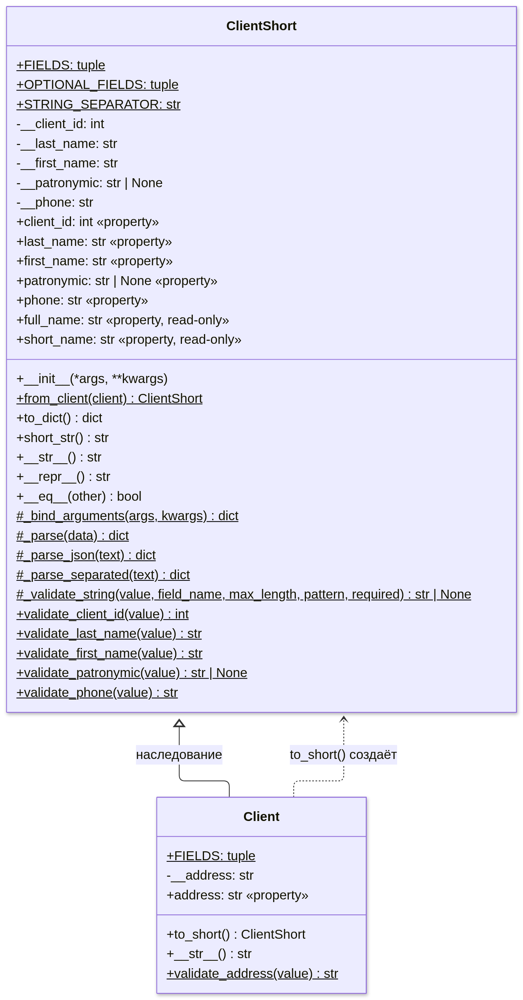

# Диаграмма классов

Исходник диаграммы (Mermaid): [class_diagram.mmd](class_diagram.mmd).

## Обозначения

| Знак | Смысл |
|---|---|
| `+` | публичный член |
| `-` | приватный член (в Python — `__имя`, name mangling) |
| `#` | защищённый член (в Python — `_имя`, по соглашению) |
| подчёркивание | статический член / метод класса (`@staticmethod`, `@classmethod`, атрибут класса) |
| `«property»` | свойство — доступ к приватному полю через getter/setter с валидацией |
| сплошная линия с треугольником | наследование `Client → ClientShort` |
| пунктирная стрелка | зависимость: `Client.to_short()` создаёт объект `ClientShort` |

## Описание

* **`ClientShort`** — базовый класс, краткая версия данных клиента
  (ФИО и один контакт — телефон, без адреса). Содержит всю общую логику:
  перегруженный конструктор (позиционные/именованные аргументы, строка
  с разделителем `;`, JSON, словарь), статическую валидацию полей,
  краткий вывод, `repr` и сравнение на равенство.
* **`Client`** — полная версия клиента. Наследует всё от `ClientShort`,
  добавляет только поле `address` (расширяет кортеж `FIELDS`),
  метод `validate_address`, полный вывод `__str__` и `to_short()`.

Благодаря кортежу `FIELDS` конструктор, разбор строки/JSON, `to_dict`,
`__repr__` и `__eq__` написаны один раз в базовом классе и автоматически
работают для наследника — повтора кода нет.
