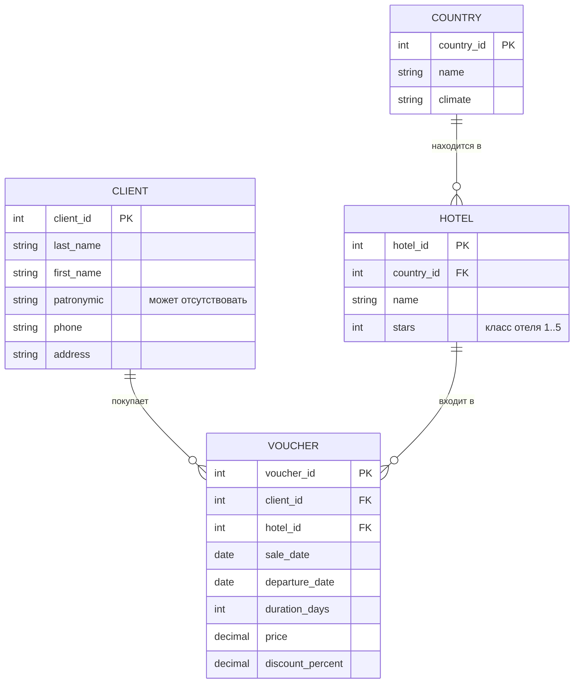

# ER-модель предметной области «Туристическая фирма»

Фирма продаёт клиентам путёвки. У клиента фиксируются ФИО, адрес и телефон.
Клиенту подбирают страну (с особенностями климата) и отель определённого класса,
обсуждают длительность пребывания и стоимость. При продаже путёвки фиксируется
дата отправления; клиенту может быть предоставлена скидка. Если клиент покупает
несколько путёвок, каждая путёвка — отдельная запись.

## Диаграмма

## Таблицы

| Таблица | Назначение | Ключи |
|---|---|---|
| `client` | Клиенты фирмы | PK `client_id` |
| `country` | Страны и их климат | PK `country_id` |
| `hotel` | Отели (класс 1–5 звёзд) | PK `hotel_id`, FK `country_id → country` |
| `voucher` | Проданные путёвки | PK `voucher_id`, FK `client_id → client`, FK `hotel_id → hotel` |

## Обоснование 3НФ

* **1НФ** — все атрибуты атомарны: ФИО разбито на фамилию, имя и отчество,
  несколько путёвок одного клиента хранятся отдельными строками `voucher`.
* **2НФ** — во всех таблицах простой первичный ключ (суррогатный id),
  поэтому частичных зависимостей от части ключа нет.
* **3НФ** — нет транзитивных зависимостей:
  * страна путёвки не хранится в `voucher`, она определяется через `hotel.country_id`;
  * климат хранится только в `country`, а не в отеле или путёвке;
  * данные клиента не дублируются в путёвке — только внешний ключ `client_id`.
